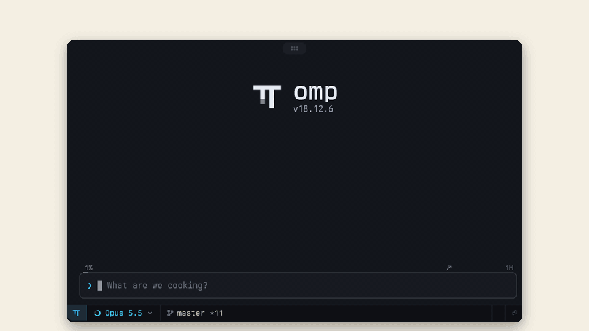

# omp-stretch

**Your agent writes a wall of text, you don't need to read it all.**



Replies arrive short: one clause per paragraph or list item. Pick a linked phrase and its detail grows right where it stands; pick `«` and it shrinks back. At the bottom of a stretch, pick ✦ and the model writes more right there. The model is told which parts you opened, so it doesn't assume you read the rest. In Tern you pick by clicking. In a plain terminal you press `Alt+O` and type the letter tagged on the phrase, or click it with omp's mouse mode on.

Shamelessly copying [cc-stretch](https://github.com/pro-vi/cc-stretch), the stretchtext plugin for Claude Code, brought to [omp](https://github.com/can1357/oh-my-pi), in Tern and in plain terminals.

## Install

```sh
omp plugin marketplace add materemias/omp-stretch
omp plugin install omp-stretch@omp-stretch
```

Then set it up for where you run omp:

- **Plain terminal** (kitty, Ghostty, WezTerm, tmux, …), omp 18.17.0 or newer: turn on **Tools → Extensions → Extension Reply Renderers** in omp's settings, or add this to `~/.omp/agent/config.yml`:

  ```yaml
  extensionRenderers:
    assistantText: true
  ```

  Then pick how you open stretches. `Alt+O` works out of the box (omp's link hint key, `app.links.hint`). To click them instead, also turn on **Appearance → Display → Mouse Click-to-Focus**, or add `mouse: true` under `tui:` in `config.yml`. While mouse mode is on, omp takes over the mouse: select text with `Shift`+drag and scroll with `Shift`+wheel.
- **Tern**, omp 18.11.0 or newer: link the Tern plugin, which opens stretches on click:

  ```sh
  tern plugin link ~/.omp/plugins/node_modules/omp-stretch/tern-plugin
  ```

Restart omp, then run `/stretch status`. Its `Clicks:` line should say `on`; if it says `off`, it lists what a plain terminal needs. Until then, stretches show fully open and the model isn't asked to write them.

Using omp on another machine through Tern remoting? Install the Tern plugin on both: on the machine running omp as above, and on the one whose Tern window you click in. The window side needs no omp:

```sh
tern plugin install github.com/materemias/omp-stretch/tern-plugin
```

If you use omp's advisor, add this line to `~/.omp/agent/WATCHDOG.md` so it knows the `{{short|long}}` markup is the reply format and doesn't ask the agent to remove it:

```
@~/.omp/plugins/node_modules/omp-stretch/advisor.md
```

To update, run `omp plugin upgrade omp-stretch@omp-stretch`. In Tern, run the `tern plugin link` line again too: Tern remembers the versioned folder the link pointed to.

## In a plain terminal

Set up as in [Install](#install). `Extension Reply Renderers` is off by default: while it's off, omp never asks the extension to draw replies.

`Alt+O` puts a letter over each stretch link on screen, and the footer shows that key (or yours, if you rebound `app.links.hint`) while the last reply has stretches. Type the letter to open that stretch, its `«` to close it, or its ✦ to ask for more. With mouse mode on (see [Install](#install)), click the link instead. For links that have scrolled up into the terminal's scrollback, press `Alt+O` twice: omp opens the whole transcript fullscreen with the same letters, and the stretch opens in place there.

`Alt+O` is omp's default, and it takes the key from any other action you bound there. To use another key, set `app.links.hint` in `~/.omp/agent/keybindings.yml`, for example `app.links.hint: [Alt+E]`. The footer follows your binding.

A stretch opens at once instead of growing word by word, and a ✦ answer appears when it's finished while the footer counts the seconds. omp redraws a reply in scrollback by rebuilding the whole scrollback, so neither can animate there.

## Benefits

You read about 40% fewer words before clicking anything: 157 words per reply against 263 before, across my recent sessions. The detail is one click away, and details can hold further details. The cost is about 0.3% of a session's cost: the model writes every level up front, so you read less, but you don't pay less.

`/stretch dense` (default) shows the gist, `/stretch light` keeps a sentence or two in view, and `/stretch off` turns stretches off. `/stretch section` (experimental) folds each section under a heading into one line; opening it shows that section in dense form. The choice applies to every omp session. `/stretch status` shows what's actually in effect.

Deep in a long session the model tends to stop writing stretches, and one plain reply tends to be followed by more. So when a reply comes back with 800 or more characters of prose (code blocks aside) and no stretches, your next message carries a one-line reminder, about 30 tokens.

## Ask for more

When a stretch and every stretch inside it are open, it ends in `✦ «`. Pick ✦ and the model writes what comes next in that section, right there, as another stretch you can open further or deepen again. It runs as a side question over the whole conversation, like `/btw`, so the transcript stays as it was; the model hears what it added with your next message. Answers are saved with the session.

A press is a model call. It reuses the conversation's prompt cache and is capped at 1,500 output tokens where the model allows a cap; on Codex, Cursor and budget-thinking models with thinking on, it runs uncapped.

## On your phone

[tern-awui](https://github.com/materemias/tern-awui), the phone and browser companion for omp in Tern, shows the same stretches as links. Open one on the phone and it opens in the Tern pane too, and the reverse; ✦ works from the phone as well, with the pane's model. The model's read note counts what you opened on either side. Each app works without the other.

## Limits

- **It can break with any omp release.** To draw replies, this patches an internal omp method. If that method changes, the extension turns itself off, or at worst shows the raw `{{short|long}}` markup. Your sessions always keep the full text. In a plain terminal, the links and their picks go through omp's extension API ([#16238](https://github.com/can1357/oh-my-pi/pull/16238), [#16239](https://github.com/can1357/oh-my-pi/pull/16239), [#16476](https://github.com/can1357/oh-my-pi/pull/16476)); Tern still needs the patch and the Tern plugin.
- Which stretches are open is forgotten when omp restarts.
- `/btw` answers come plain, since that panel can't open stretches.
- A literal placeholder without a pipe, such as `{{name}}`, stays unchanged. Put template expressions containing pipes in code spans so they are not mistaken for stretches.
- omp's "Copy answer" copies the reply as drawn: closed stretches stay short, and their links only work in this omp.

MIT. The parser, the growth logic and the guide are ported from cc-stretch (MIT).
