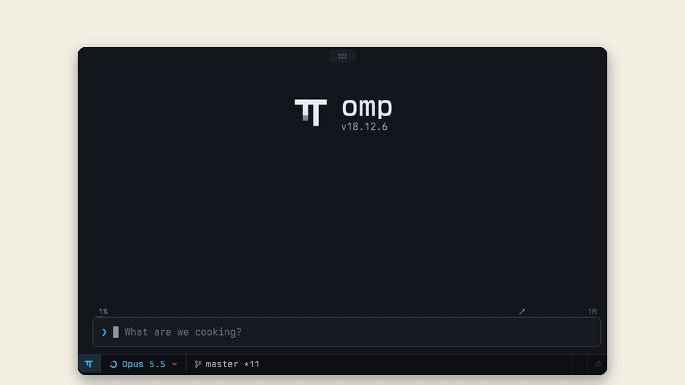

# omp-stretch

**Your agent writes a wall of text, you don't need to read it all.**



Replies arrive short: one clause per paragraph or list item. Click a linked phrase and its detail grows right where it stands; click `«` and it shrinks back. At the bottom of a stretch, click ✦ and the model writes more right there. The model is told which parts you opened, so it doesn't assume you read the rest.

Shamelessly copying [cc-stretch](https://github.com/pro-vi/cc-stretch), the stretchtext plugin for Claude Code, brought to [omp](https://github.com/can1357/oh-my-pi) in Tern.

## Install

```sh
omp plugin marketplace add materemias/omp-stretch
omp plugin install omp-stretch@omp-stretch
tern plugin link ~/.omp/plugins/node_modules/omp-stretch/tern-plugin
```

Restart omp; `/stretch status` confirms it loaded. Needs omp 18.11.0 or newer. Outside Tern, stretches show fully open; inside Tern, the Tern plugin is required to open them.

To update, run `omp plugin upgrade omp-stretch@omp-stretch`, then the `tern plugin link` line again: Tern remembers the versioned folder the link pointed to.

## Benefits

You read about 40% fewer words before clicking anything: 157 words per reply against 263 before, across my recent sessions. The detail is one click away, and details can hold further details. The cost is about 0.3% of a session's cost: the model writes every level up front, so you read less, but you don't pay less.

`/stretch dense` (default) shows the gist, `/stretch light` keeps a sentence or two in view, and `/stretch off` turns stretches off. The choice applies to every omp session. `/stretch status` shows what's actually in effect.

## Ask for more

When a stretch and every stretch inside it are open, it ends in `✦ «`. Click ✦ and the model writes what comes next in that section, right there, as another stretch you can open further or deepen again. It runs as a side question over the whole conversation, like `/btw`, so the transcript stays as it was; the model hears what it added with your next message. Answers are saved with the session.

A press is a model call. It reuses the conversation's prompt cache and is capped at 1,500 output tokens where the model allows a cap; on Codex, Cursor and budget-thinking models with thinking on, it runs uncapped.

## On your phone

[tern-awui](https://github.com/materemias/tern-awui), the phone and browser companion for omp in Tern, shows the same stretches as links. Open one on the phone and it opens in the Tern pane too, and the reverse. The model's read note counts what you opened on either side. Each app works without the other.

## Limits

- **It can break with any omp release.** omp has no API yet for drawing replies differently or for clicks, so this patches an internal omp method. If that method changes, the extension turns itself off, or at worst shows the raw `{{short|long}}` markup. Your sessions always keep the full text. The proper API is ready upstream: [#16238](https://github.com/can1357/oh-my-pi/pull/16238), [#16239](https://github.com/can1357/oh-my-pi/pull/16239) and [#16476](https://github.com/can1357/oh-my-pi/pull/16476). Once those are merged, stretches will move to that API and work in plain terminals too.
- Which stretches are open is forgotten when omp restarts.
- `/btw` answers come plain, since that panel can't open stretches.
- A literal placeholder without a pipe, such as `{{name}}`, stays unchanged. Put template expressions containing pipes in code spans so they are not mistaken for stretches.
- omp's "Copy answer" copies the reply as drawn: closed stretches stay short, and their links only work in this omp.
- tern-awui doesn't show ✦ answers yet, and ✦ can only be pressed in the Tern pane.

MIT. The parser, the growth logic and the guide are ported from cc-stretch (MIT).
